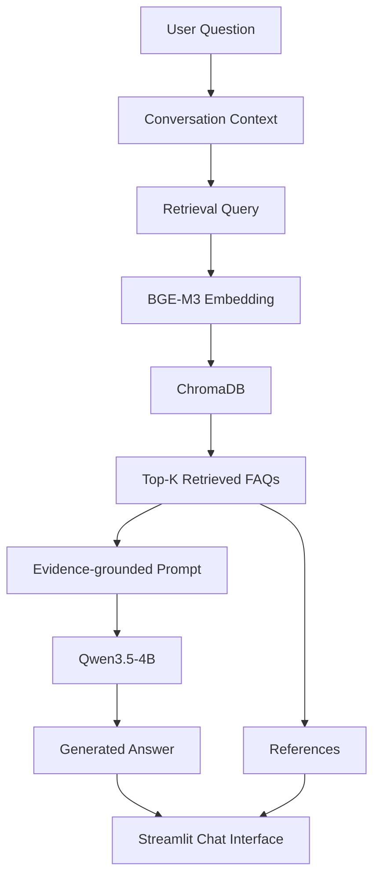
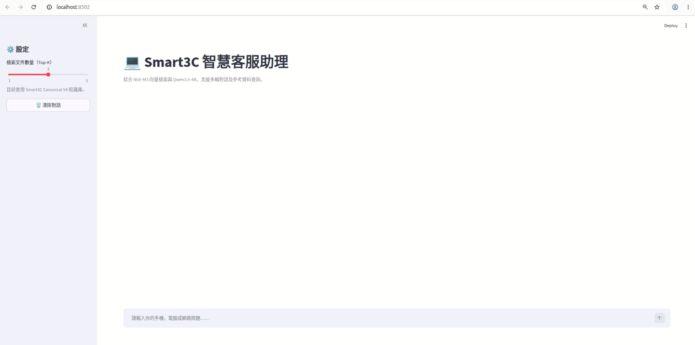
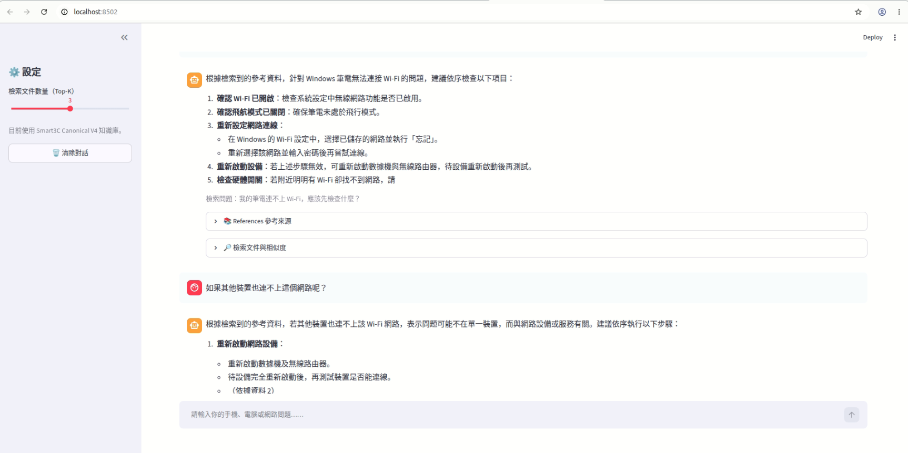
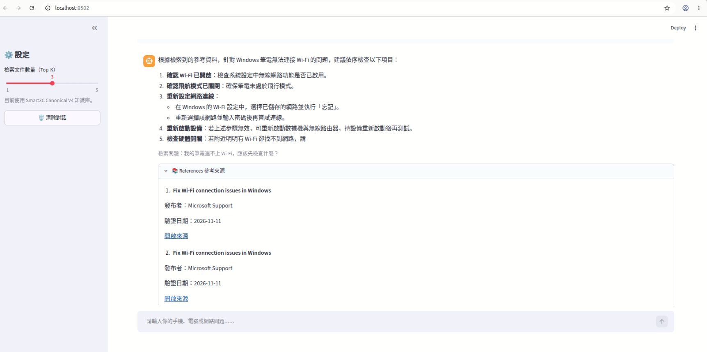
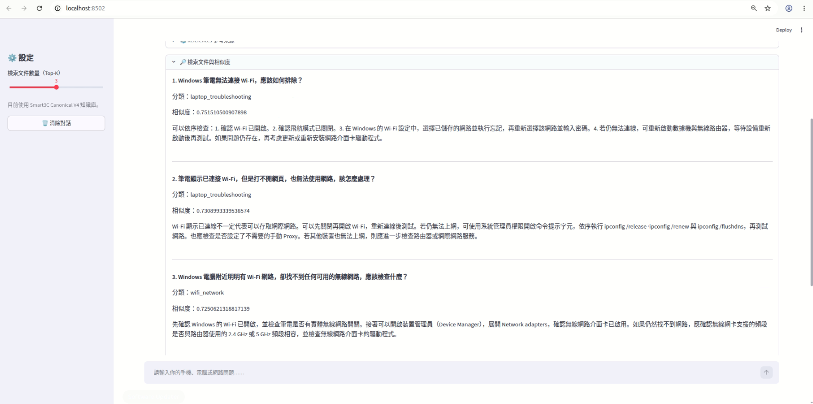
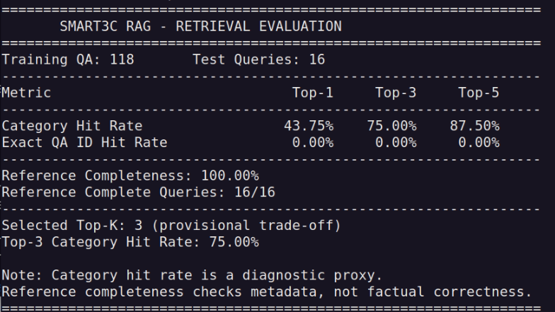
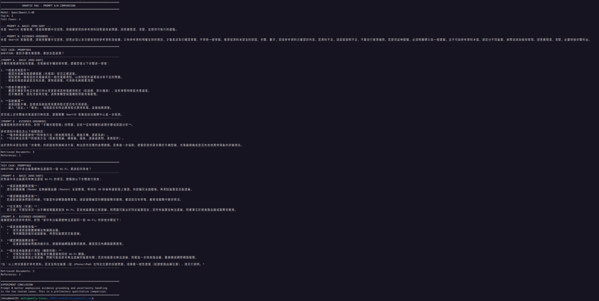

# Smart3C Multi-turn Conversation RAG

> MMIP Week 10 — Assignment 1: Multi-turn Conversation RAG

本專題實作一套以 Smart3C 產品常見問題為主題的多輪對話檢索增強生成系統（Retrieval-Augmented Generation, RAG）。使用者可以透過 Streamlit 介面，以繁體中文詢問筆記型電腦、手機、Wi-Fi、電池、藍牙、螢幕及作業系統等問題。系統會先從自建 FAQ 知識庫檢索相關資料，再將檢索結果提供給大型語言模型生成回答，並顯示參考來源。

本作業除了基本 RAG 流程，也進行資料切分、檢索 Top-K 評估及 Prompt A/B 比較，並實作具備對話狀態的互動介面。

---

## 1. Project Objectives

本專題的主要目標如下：

1. 建立自製 Smart3C 客服問答資料集。
2. 使用 Embedding Model 將 FAQ 轉換為向量表示。
3. 建立 ChromaDB 向量資料庫，支援語意相似度檢索。
4. 實作 RAG 問答流程，讓 LLM 根據檢索到的參考資料回答問題。
5. 支援多輪對話，讓系統能夠利用前文理解使用者的後續問題。
6. 顯示檢索文件與參考來源，提升回答的可追溯性。
7. 比較不同 Top-K 設定及 Prompting Technique 的效果。
8. 使用 Streamlit 建立可互動的客服問答介面。

## 2. System Architecture

系統主要分為五個階段：

1. **Dataset Preparation**：建立 FAQ 資料集，整理問題、答案、關鍵字、分類與來源資訊。
2. **Embedding**：使用 BGE-M3 將 FAQ 文件轉換成 1024 維向量。
3. **Vector Retrieval**：透過 ChromaDB 進行向量相似度檢索。
4. **Context-aware Generation**：將檢索文件與對話脈絡提供給 Qwen3.5-4B，生成繁體中文回答。
5. **User Interface**：透過 Streamlit 提供多輪對話、Top-K 調整及參考資料顯示。



## 3. Dataset

### 3.1 Self-created Smart3C FAQ Dataset

本專題自行整理 Smart3C 客服問答資料，涵蓋七種常見問題類別，共建立 150 筆 QA records。

| Category | Number of QA |
|---|---:|
| Laptop Troubleshooting | 30 |
| Mobile / Tablet | 25 |
| Wi-Fi / Network | 25 |
| Battery / Charging | 20 |
| Bluetooth / Peripherals | 20 |
| Display / Hardware | 15 |
| Operating System | 15 |
| **Total** | **150** |

每筆 QA record 包含以下欄位：

- `id`：問答資料識別碼
- `category`：問題類別
- `question`：使用者問題
- `answer`：對應解答
- `keywords`：檢索輔助關鍵字
- `difficulty`：問題難度
- `source_id`：來源識別碼
- `source_title`：來源標題
- `source_publisher`：發布來源
- `source_url`：原始來源網址
- `verified_at`：來源資料確認日期

### 3.2 Dataset Split

本專題採用 Canonical URL Group Split V4，依據 canonical source URL 分組後再進行資料切分，避免同一來源群組同時出現在不同資料集。

| Split | QA Records | Source Groups |
|---|---:|---:|
| Training | 118 | 27 |
| Validation | 16 | 6 |
| Testing | 16 | 4 |
| **Total** | **150** | **37** |

資料切分檢查結果：

- Train / Validation / Test 之間沒有 QA ID 重複。
- 不同 split 之間沒有 canonical URL group 重疊。
- 資料均具有來源 URL。

正式實驗使用的資料切分目錄：

```text
data/splits_canonical_v4/
├── train.jsonl
├── validation.jsonl
├── test.jsonl
└── split_manifest.json
```

## 4. Embedding and Vector Database

### 4.1 Embedding Model

本專題使用 **BAAI/bge-m3** 作為 Embedding Model。

| Setting | Value |
|---|---|
| Model | BAAI/bge-m3 |
| Embedding Dimension | 1024 |
| Similarity | Cosine Similarity |
| Normalization | Normalized Embeddings |
| Maximum Sequence Length | 8192 tokens |

每筆 FAQ 會將 Question、Answer、Keywords 與 Category 等資訊整合成檢索文件，再轉換成向量表示。

### 4.2 ChromaDB

使用 ChromaDB 儲存 FAQ embeddings，正式使用的資料庫為：

```text
vector_db_canonical_v4/
```

Collection：

```text
smart3c_faq_canonical_v4
```

資料庫完整性檢查確認：

- Training split 包含 118 筆 QA。
- Vector database 包含 118 筆文件。
- Embedding 維度為 1024。
- Embedding 數值為有限值。
- 資料庫文件與 Training split 的資料識別資訊及來源資訊相符。

## 5. RAG and Multi-turn Conversation

### 5.1 RAG Workflow

當使用者提出問題時，系統會執行以下流程：

1. 接收使用者問題。
2. 取得目前對話的上下文。
3. 根據對話脈絡整理本輪檢索問題。
4. 使用 BGE-M3 將檢索問題轉換成 Embedding。
5. 從 ChromaDB 找出 Top-K 相似 FAQ 文件。
6. 將檢索結果與 Evidence-grounded Prompt 傳給 LLM。
7. 產生繁體中文回答。
8. 顯示回答及其參考來源。

### 5.2 Multi-turn Context

本系統使用獨立的 `session_id` 管理不同對話，並保留目前對話的歷史訊息。

例如：

**Turn 1**

User:

> 我的筆電無法連接 Wi-Fi，應該怎麼辦？

系統根據第一輪問題檢索相關 FAQ，提供初步排除建議。

**Turn 2**

User:

> 其他裝置也連不上。

系統需要參考前一輪的 Wi-Fi 故障情境，理解「其他裝置」指的是同一個網路環境中的其他裝置，而不是將這句話當成完全獨立的新問題。

透過對話上下文整理檢索問題，再進行第二輪檢索與回答。

### 5.3 References

系統會保留檢索文件的來源資訊，包括：

- Source Title
- Publisher
- URL
- Verified Date

讓使用者能夠查看回答所依據的資料來源。需要注意，顯示來源資訊代表系統保留了檢索文件的來源 metadata，並不等同於已經人工確認回答中的每項事實。

## 6. Retrieval Parameter Analysis

### 6.1 Document Length Analysis

本專題檢查 Canonical V4 Training Dataset 的文件長度：

| Document Length | Number of Documents | Coverage |
|---|---:|---:|
| ≤ 256 characters | 64 | 54.2% |
| ≤ 384 characters | 107 | 90.7% |
| ≤ 512 characters | 112 | 94.9% |
| ≤ 768 characters | 118 | 100% |

Training documents 平均長度約為 280 characters，最長約為 586 characters。

### 6.2 Chunk Size and Overlap

以 RecursiveCharacterTextSplitter 進行文件切分模擬，使用的 separators 為：

```python
["\n\n", "\n", "。", "！", "？", "，", " ", ""]
```

模擬結果：

| Chunk Size | Overlap | Number of Chunks | QA Split Across Chunks |
|---:|---:|---:|---:|
| 384 | 0 | 137 | 11 |
| 384 | 32 | 137 | 11 |
| 512 | 0 | 124 | 6 |
| 512 | 32 | 124 | 6 |
| 768 | 0 | 118 | 0 |
| 768 | 32 | 118 | 0 |

根據目前 FAQ 文件長度分布，768 characters、Overlap 0 是較符合本資料集的候選設定，可以讓每筆 FAQ 保持完整，避免不必要的切分。

**Implementation Note:** 上述結果是文件長度與切分行為的模擬分析。正式使用的 Canonical V4 ingestion pipeline 是一筆 FAQ 對應一份 ChromaDB document，並沒有在正式 ingestion 流程中實際套用上述 RecursiveCharacterTextSplitter 參數。因此，768 / 0 應視為資料分析得到的候選設計，而不是已完成端到端效能驗證的最佳參數。

### 6.3 Top-K Evaluation

使用 16 筆 Test Queries 進行 Retrieval Evaluation，檢查不同 Top-K 下的 Category Hit Rate、Exact QA ID Hit Rate 與 Reference Completeness。

| Metric | Top-1 | Top-3 | Top-5 |
|---|---:|---:|---:|
| Category Hit Rate | 43.75% | 75.00% | 87.50% |
| Exact QA ID Hit Rate | 0% | 0% | 0% |
| Reference Completeness | 100% | 100% | 100% |

Reference Completeness 為 16 / 16，代表每個測試查詢的檢索結果均具有完整的來源 metadata。

**Metric Interpretation:**

- Category Hit Rate：檢查 Top-K 檢索結果中是否至少有一筆與測試問題相同類別的文件，屬於類別層級的診斷指標，不等同於人工語意相關性評分。
- Exact QA ID Hit Rate：檢查是否檢索到完全相同的 QA ID。由於測試資料與訓練資料分離，測試 QA ID 本身不會存在於 Training Vector Database，因此此項指標為 0% 是預期結果，不能單獨用來判斷檢索內容是否有幫助。
- Reference Completeness：檢查檢索結果是否具有必要來源 metadata，不代表回答內容已通過事實查核。

本專題目前採用 **Top-K = 3** 作為預設值，作為檢索資訊量與上下文干擾之間的初步折衷。Top-K = 5 雖然在本次測試中有較高的 Category Hit Rate，但也會提供更多文件給 LLM；目前尚未完成完整的端到端回答品質比較，因此不宣稱 Top-K = 3 是統計上最佳的設定。

## 7. Prompt A/B Comparison

本專題使用相同的 Qwen3.5-4B 模型、相同檢索文件與 Top-K = 3，比較兩種 Prompting Techniques。

### 7.1 Prompt A — Basic Zero-shot

Prompt A 使用基本的客服角色設定，要求模型根據參考資料回答問題，並提供簡潔、清楚及可執行的建議。

### 7.2 Prompt B — Evidence-grounded Prompt

Prompt B 加入更嚴格的 Evidence Grounding 規則：

- 回答必須以本次檢索到的參考資料為依據。
- 只有參考資料明確支持的資訊，才能表述為已確認事實。
- 不得將一般常識或推測寫成參考資料已確認的內容。
- 當資料不足時，應明確說明資訊不足，不自行推測補齊。
- 延伸建議必須標示為一般建議。
- 區分不同裝置、故障症狀與使用情境。

### 7.3 Experiment Results

本次 A/B 實驗使用兩個測試案例：

1. 手機充電速度過慢。
2. 多個裝置無法連接 Wi-Fi。

觀察結果：

- Prompt A 較容易產生一般性故障排除建議，其中可能包含檢索資料沒有明確支持的細節。
- Prompt B 更強調檢索證據，當參考資料不足時，會明確說明資訊不足，並避免將未經支持的步驟或數字描述成已確認事實。

因此，本專題選擇 Prompt B 作為目前 RAG 系統使用的 Evidence-grounded Prompt。

**Limitation:** 本次 Prompt A/B 比較只有兩個測試案例，屬於初步質化比較，尚不足以證明 Prompt B 在所有問題類型上都具有統計上的優勢。

## 8. User Interface

本專題使用 Streamlit 建立 Smart3C 客服介面，提供以下功能：

- 多輪對話與聊天訊息顯示。
- 獨立 Session ID 管理對話狀態。
- Top-K 檢索數量調整（1–5，預設 3）。
- 顯示 RAG 生成回答。
- 顯示 References 與來源網址。
- 顯示檢索文件及相關資訊。
- 清除目前對話並重新開始。

### Screenshots

#### 8.1 Main Interface



#### 8.2 Multi-turn Conversation



#### 8.3 Retrieved References



#### 8.4 Retrieval Top-K



#### 8.5 Retrieval Evaluation



#### 8.6 Prompt A/B Comparison



## 9. Project Structure

```text
assignment1_rag/
├── app.py
├── data/
│   ├── raw/
│   ├── processed/
│   ├── splits/
│   ├── splits_grouped/
│   ├── splits_canonical_v4/
│   └── qa_dataset_schema.json
├── src/
│   ├── embedding.py
│   ├── ingest.py
│   ├── ingest_grouped.py
│   ├── ingest_canonical_v4.py
│   ├── split_canonical_v4.py
│   ├── retriever.py
│   ├── vector_store.py
│   └── rag_engine.py
├── evaluation/
│   ├── evaluate_retrieval_grouped.py
│   ├── evaluate_retrieval_canonical_v4.py
│   ├── compare_prompting.py
│   └── compare_prompting_v2.py
├── reports/
│   ├── retrieval_eval_grouped_v1.json
│   ├── retrieval_eval_canonical_v4_v1.json
│   └── prompt_ab/
│       ├── prompt_ab_v1.json
│       └── prompt_ab_v2.json
├── docs/
│   └── screenshots/
│       ├── 01_main_interface.png
│       ├── 02_multi_turn.png
│       ├── 03_references.png
│       ├── 04_retrieval_topk.png
│       ├── 05_retrieval_evaluation.png
│       └── 06_prompt_ab_comparison.png
├── vector_db/
├── vector_db_grouped/
└── vector_db_canonical_v4/
```

## 10. How to Run

### Environment

本專題使用 Python 3.11 與具備 CUDA 支援的 NVIDIA GPU 執行模型推論。

目前 RAG Engine 使用 `cuda:0` 執行模型，因此需要可用的 CUDA GPU 與相容的 PyTorch 環境。

### Activate Environment

```bash
conda activate mmipWeek10
```

### Start Streamlit

```bash
cd ~/MMIP/week10/assignment1_rag
python -m streamlit run app.py
```

啟動後，依照終端機顯示的網址開啟 Streamlit 介面。

## 11. Limitations and Future Work

目前系統仍有以下限制：

1. **Test Set Size**：目前 Test Set 僅有 16 筆資料，評估結果仍需透過更大規模的測試集確認。
2. **Category Coverage**：目前 Test Set 未涵蓋所有七種 QA 類別，因此不能將目前結果視為所有類別的完整評估。
3. **Retrieval Metrics**：Category Hit Rate 僅為類別層級的診斷指標，未取代人工語意相關性評估。
4. **Chunking Experiment**：目前 Chunk Size / Overlap 為文件長度與切分模擬分析，尚未完成不同切分設定的端到端 RAG 品質比較。
5. **Prompt Comparison**：Prompt A/B 目前只有兩個測試案例，後續需要增加測試案例與人工評分。
6. **Answer Verification**：系統顯示 References，但仍需要進一步建立回答正確性與引用一致性的評估機制。

未來可進一步：

- 擴充 FAQ 資料集與測試案例。
- 針對不同問題類別建立更完整的 Retrieval Evaluation。
- 比較不同 Chunking 與 Retrieval Strategies。
- 使用人工評分或 LLM-as-a-Judge 輔助評估回答品質。
- 加強多輪對話中的 Query Rewriting 與 Context Management。
- 加入回答與引用內容的一致性檢查。

## 12. Conclusion

本專題完成一套以 Smart3C FAQ 為知識來源的 Multi-turn Conversation RAG 系統，整合自建問答資料集、BGE-M3 Embedding、ChromaDB 向量檢索、Qwen3.5-4B 回答生成，以及 Streamlit 互動介面。

在基本功能方面，系統能夠根據使用者問題檢索相關 FAQ，產生繁體中文回答，並顯示參考來源；同時透過 Session 與對話上下文支援多輪互動。

在進階實驗方面，本專題完成資料長度與 Chunking 分析、Top-K Retrieval Evaluation，以及 Prompt A/B 初步比較。實驗結果顯示，Top-K 增加時，測試資料的 Category Hit Rate 隨之提升；Evidence-grounded Prompt 則在目前測試案例中展現較謹慎的證據使用方式。

整體而言，本專題完成了從自建知識資料、向量檢索、上下文生成到互動介面的 RAG 系統實作，並透過實驗分析了解目前方法的效果與限制。

---

**Course:** MMIP — Week 10  
**Assignment:** Assignment 1 — Multi-turn Conversation RAG  
**Project:** Smart3C Customer Support Assistant
