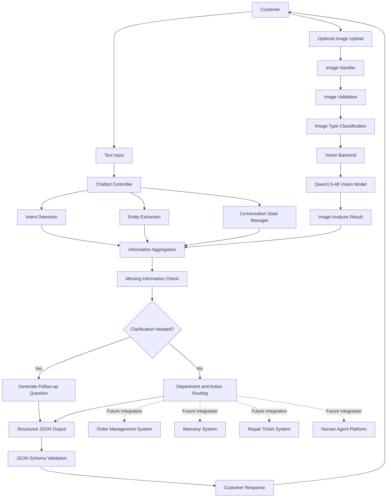
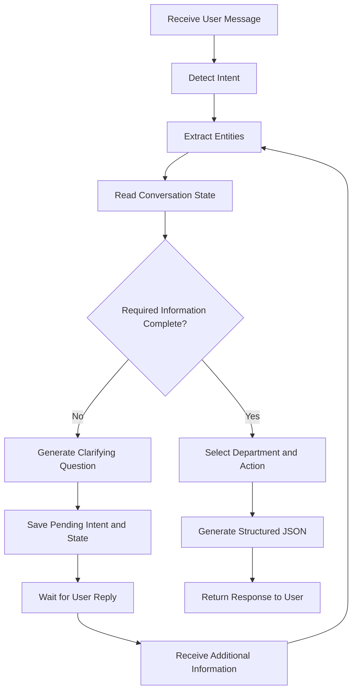
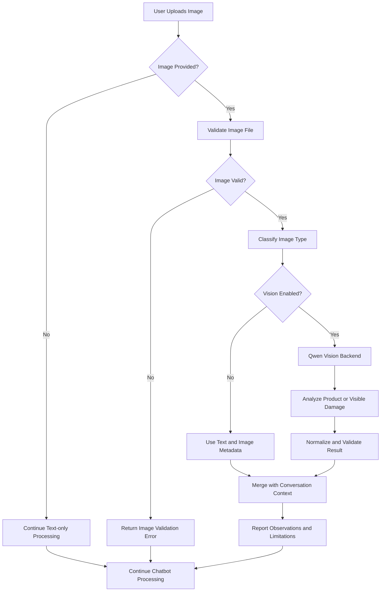

# Week 9 MMIP Assignment 1
# Multimodal Multi-turn Conversational Chatbot

## 1. Project Overview

This project implements a multimodal and multi-turn customer service chatbot for a 3C electronics after-sales service platform.

The system accepts text messages and optional images, identifies user intent, extracts relevant entities, maintains conversation context, generates structured JSON, and determines the appropriate downstream department.

Main objectives:
- Understand customer requests from text and images.
- Identify user intent and extract relevant information.
- Maintain context across multiple conversation turns.
- Detect missing information and ask follow-up questions.
- Generate standardized JSON output.
- Route requests to the appropriate department.
- Handle invalid inputs, uncertainty, and exceptional situations.

## 2. Business Scenario

Customers may need assistance with product questions, order tracking, warranty checking, repair requests, and returns or refunds.

Users may provide information gradually. For example, a customer may first report a damaged laptop and then provide the product model or upload a photograph in a later turn.

The target users are customers who have purchased laptops, smartphones, tablets, and other electronic devices.

### 2.1 Supported Scenarios

| Scenario | Example | Expected Task |
|---|---|---|
| FAQ | How do I set up my laptop? | Answer product questions |
| Order tracking | Where is my order? | Track an order |
| Warranty checking | Is my ASUS laptop under warranty? | Check warranty |
| Repair request | My MacBook screen is broken. | Handle a repair request |
| Return/refund | I want to return this product. | Handle return/refund |
| Human handoff | I want to speak to a person. | Transfer to a human agent |
| Unclear request | Can you help me? | Ask follow-up questions |

## 3. Downstream Tasks and Routing

| Intent | Department | Action |
|---|---|---|
| faq | general_support | answer_faq |
| order_tracking | order_support | track_order |
| warranty_check | warranty_service | check_warranty |
| repair_request | repair_center | create_repair_request |
| return_refund | returns_refunds | start_return_refund |
| human_handoff | human_agent | handoff_to_human |
| unknown | general_support | ask_follow_up |

### 3.1 Required Information

| Task | Required Information | Missing Information Handling |
|---|---|---|
| FAQ | User question | Ask for clarification |
| Order tracking | Order ID | Request the order ID |
| Warranty checking | Product and purchase information | Request missing information |
| Repair request | Product and problem description | Ask for product information |
| Return/refund | Product and return reason | Request additional information |
| Human handoff | User request | Route to a human agent |

The current implementation performs intent detection, entity extraction, missing-information checks, and department/action selection. Routing outputs such as `create_repair_request` are decisions only; actual external service transactions are not yet integrated.

## 4. Structured Output Specification

The chatbot returns a standardized JSON object. Its structure is defined in `config/output_schema.json` using JSON Schema Draft 2020-12.

The root object contains exactly six required fields. Additional properties are not allowed.

### 4.1 Top-level Fields

| Field | Type | Purpose |
|---|---|---|
| intent | object | Intent category, confidence, and clarification status |
| entities | object | Extracted product and order information |
| image_analysis | object | Image availability, observations, damage, and limitations |
| conversation_state | object | Session and multi-turn conversation information |
| routing | object | Department, action, priority, and human-handling decision |
| response | object | User-facing message and suggested questions |

### 4.2 Field Details

**intent**
- `category`: faq, order_tracking, warranty_check, repair_request, return_refund, human_handoff, other, or unknown.
- `confidence`: numeric value from 0 to 1.
- `needs_clarification`: boolean indicating whether more information is needed.

**entities**
- `product_name`: product brand or name; string or null.
- `product_model`: product model; string or null.
- `order_id`: order identifier; string or null.
- `purchase_date`: purchase date; string or null.
- `problem_description`: customer problem description; string or null.

**image_analysis**
- `image_provided`: boolean indicating whether an image was supplied.
- `image_type`: product, damage, receipt, order_information, other, unknown, or none.
- `observations`: array of visual observations.
- `visible_damage`: visible damage description; string or null.
- `limitations`: array describing what cannot be reliably determined from the image.

**conversation_state**
- `session_id`: unique conversation session identifier.
- `turn_count`: current turn number; integer greater than or equal to 1.
- `collected_information`: array of information collected during the conversation.
- `missing_information`: array of information still required.
- `previous_intent`: previous intent; string or null.
- `awaiting_user_input`: boolean indicating whether the system expects another user response.

**routing**
- `department`: general_support, order_support, warranty_service, repair_center, returns_refunds, human_agent, security_review, or none.
- `action`: answer_faq, track_order, check_warranty, create_repair_request, start_return_refund, ask_follow_up, handoff_to_human, security_review, or no_action.
- `priority`: low, normal, high, or urgent.
- `requires_human`: boolean indicating whether human assistance is required.
- `reason`: explanation of the routing decision.

**response**
- `message`: response message shown to the customer.
- `language`: zh-TW or en.
- `suggested_questions`: array of suggested follow-up questions.

### 4.3 Schema Validation Rules

- All six root fields are required.
- Every nested object rejects undefined additional properties.
- Confidence must be between 0 and 1.
- Turn count must be at least 1.
- Nullable entity fields explicitly accept either a string or null.
- Enum fields only accept predefined values.
- Image observations, limitations, collected information, missing information, and suggested questions must be arrays of strings.

The JSON Schema provides a consistent interface between chatbot reasoning and downstream service modules.


## 5. Complete System Architecture

The diagram shows the implemented chatbot pipeline and planned downstream integrations.



### 5.1 Multi-turn Conversation Flow

The chatbot preserves conversation state and resumes pending tasks when users provide missing information.



### 5.2 Image Processing and Vision Analysis

Images are validated before optional vision analysis. Visual observations are treated as evidence, not as proof of warranty eligibility.



### 5.3 Edge Cases and Failure Handling

| Edge case | System behavior |
|---|---|
| No image is uploaded | Continue with text-only processing. |
| Unsupported or corrupted image | Reject the image and return a validation error. |
| Missing order ID | Ask the user for the order ID and preserve the pending intent. |
| Missing product name for repair | Ask the user to identify the product. |
| Unknown or ambiguous intent | Ask a clarifying question and store the pending intent when available. |
| Vision model is disabled | Continue without Qwen-based image observations. |
| Vision inference fails | Report the limitation and avoid inventing visual findings. |
| Low-confidence classification | Request more details instead of making an unsupported decision. |
| Human assistance is required | Route the request to the human-agent action. |
| External service is not connected | Return the routing decision without claiming that a transaction was completed. |

The system must not infer warranty eligibility, purchase history, or repair completion from an image alone.

### 5.4 Implementation Status

| Component | Status | Description |
|---|---|---|
| Intent detection | Implemented | Detects FAQ, order, warranty, repair, refund, handoff, and unknown intents. |
| Entity extraction | Implemented | Extracts product names, order IDs, and problem descriptions. |
| Conversation state | Implemented | Tracks turns and preserves pending intents for follow-up messages. |
| Image validation | Implemented | Checks uploaded image files before analysis. |
| Qwen Vision | Implemented | Performs local image analysis when vision is enabled. |
| Structured JSON output | Implemented | Produces the six-field output defined by output_schema.json. |
| Schema validation | Implemented | Validates and normalizes vision results against the output contract. |
| Unit and integration tests | Implemented | The complete test suite has 33 passing tests. |
| Order and warranty APIs | Future work | Connect routing actions to real business systems. |
| Repair ticket creation | Future work | Integrate with an actual repair management platform. |
| Human-agent platform | Future work | Connect the handoff action to a live support channel. |

The current project demonstrates multimodal understanding, conversation-state handling, structured output, and routing decisions. External business transactions require additional API integration.

## 6. Project Structure

```text
assignment1_multimodal_chatbot/
├── config/
│   └── output_schema.json
├── docs/
│   └── architecture.md
├── images/
│   ├── corrupted.png
│   ├── real_product.jpg
│   └── sample_product.png
├── outputs/
│   ├── demo_conversation.json
│   ├── qwen_vision_real_product.log
│   └── test_report.txt
├── src/
│   ├── chatbot.py
│   ├── image_handler.py
│   ├── vision_backend.py
│   └── test_qwen_vision.py
├── tests/
│   ├── test_chatbot.py
│   ├── test_chatbot_image.py
│   ├── test_chatbot_qwen_integration.py
│   ├── test_image_handler.py
│   └── test_vision_backend.py
└── README.md
```

## 7. Installation and Usage

### 7.1 Environment

- Python 3.11
- PyTorch
- Transformers
- Pillow
- jsonschema
- NumPy
- A local copy of Qwen/Qwen3.5-4B for vision inference.

The project was developed and tested in the `mmipQuiz` Conda environment.

### 7.2 Run the Chatbot

```bash
conda activate mmipQuiz
cd ~/MMIP/week9/assignment1_multimodal_chatbot
python src/chatbot.py
```

Enter a customer message, then provide an image path or press Enter to continue without an image. Use `/reset` to start a new conversation and `/quit` to exit.

### 7.3 Run Tests

Run the automated test suite with:

```bash
python -m unittest discover -s tests -v
```

The latest verified test run completed successfully: **33 tests passed**.

## 8. Demo and Verification

The multimodal chatbot was tested with a real product damage image.

- Customer message: `我的 MacBook Pro 螢幕摔裂了，想申請維修。`
- Image: `images/real_product.jpg`
- Detected intent: `repair_request`
- Recognized product: `Apple MacBook`
- Image classification: `damage`
- Routing: `repair_center` / `create_repair_request`

The Qwen3.5-4B vision inference completed successfully and its image analysis was integrated into the structured chatbot output. The `create_repair_request` value represents a routing decision; actual repair-ticket creation requires a future repair-service integration.

