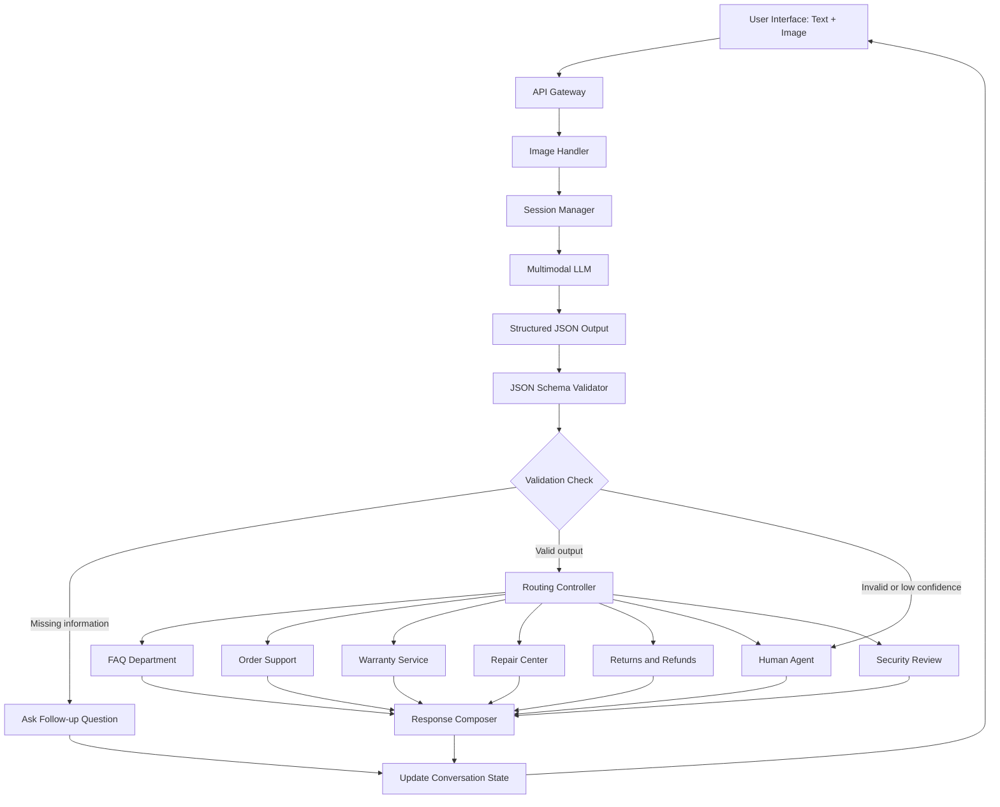

# System Architecture
## Multimodal Multi-turn 3C Customer Service Bot

## 1. System Overview

The system receives text messages and optional images from users.
It maintains conversation history and extracts user intent and entities.
A routing controller validates structured output and dispatches requests.

## 2. Technical Architecture

The system consists of the following modules:
- User Interface: Receives text and image input.
- API Gateway: Validates incoming requests.
- Image Handler: Checks image format and size.
- Session Manager: Maintains multi-turn conversation history.
- Multimodal LLM: Understands text, images, and context.
- Structured Output: Generates JSON according to the schema.
- JSON Validator: Checks output structure and required fields.
- Routing Controller: Selects the appropriate department.
- Department Services: Handles FAQ, orders, warranty, repair, and refunds.
- Response Composer: Generates the final response.

## 3. Exception Handling

- Unclear intent: Ask follow-up questions.
- Missing order ID: Request the order ID.
- Invalid image: Ask the user to upload another image.
- Contradictory information: Ask the user to confirm.
- Invalid JSON: Retry generation and use fallback if necessary.
- Low confidence: Ask for clarification or transfer to a human.
- Multiple intents: Separate and route individual tasks.
- Refund authorization: Require eligibility checks and approval.
- Prompt injection: Treat user input as untrusted data.
- Service timeout: Retry with limits and report the failure.
- Duplicate requests: Use idempotency keys.
- User abandons conversation: Save session state for later.

## 4. Architecture Diagram

## 5. Current Implementation Status

The current implementation is a rule-based prototype.

| Component | Status | Description |
|---|---|---|
| User Interface | Implemented | Terminal-based text interaction |
| API Gateway | Planned | No external API endpoint yet |
| Image Handler | Planned | Actual image upload and analysis are not implemented |
| Session Manager | Implemented | Maintains session ID and conversation state |
| Multimodal LLM | Planned | No real multimodal model integration yet |
| Structured Output | Implemented | Generates structured JSON |
| JSON Validator | Implemented | Validates output using JSON Schema |
| Routing Controller | Partially implemented | Rule-based department and action routing |
| Department Services | Planned | No real backend service integration |
| Response Composer | Implemented | Generates rule-based responses |

### Current Limitations

The prototype currently supports text-based customer service scenarios.
Image analysis, multimodal LLM inference, and real database integration
are future extensions.

The architecture diagram represents the target system design,
while the implementation status table describes the current prototype.
