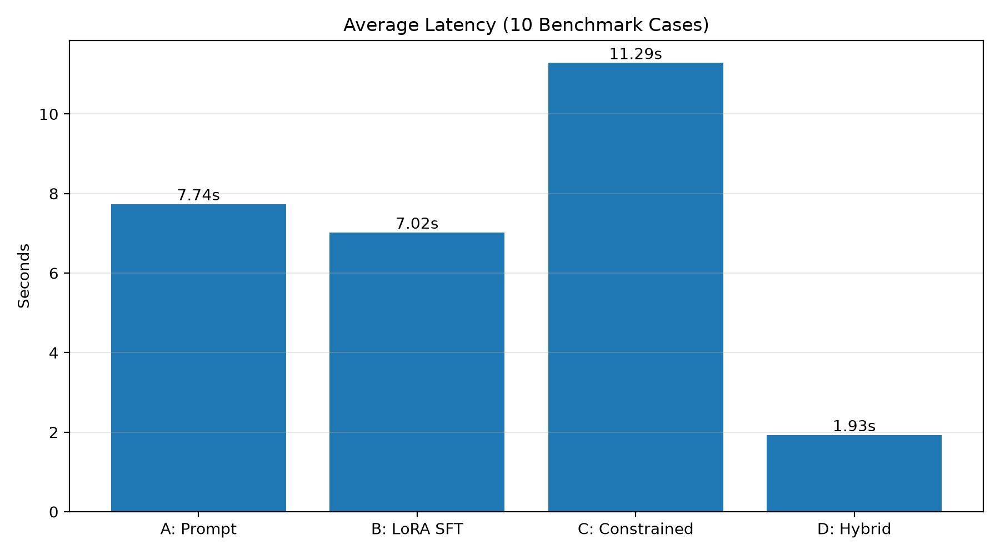
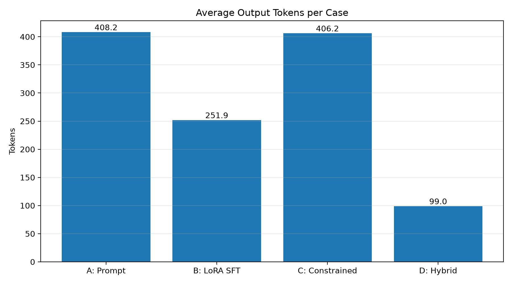
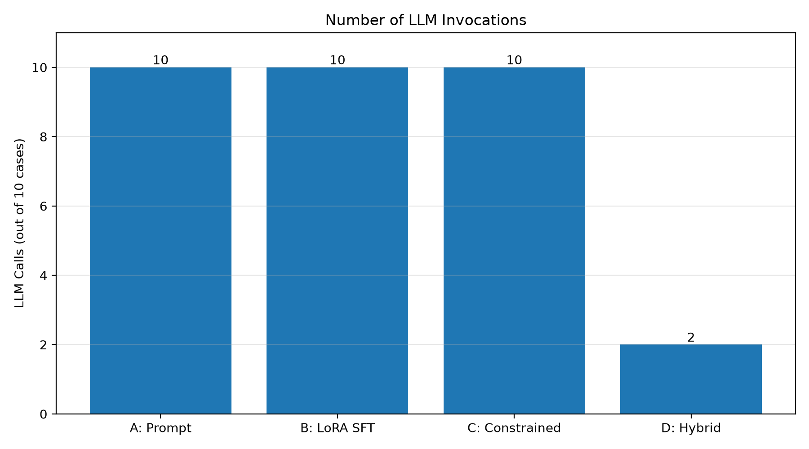

# Assignment 2 — Multimodal Customer Service Structured Output

## 1. Project Overview

本專案以多模態智慧客服（Multimodal Customer Service）為應用情境，研究如何透過不同方法引導 Vision-Language Model (VLM) / Large Language Model (LLM)，根據使用者輸入的文字與圖片，產生符合指定 JSON Schema 的結構化輸出。

系統需要理解使用者需求、辨識客服意圖、擷取產品資訊、分析圖片內容，並決定適當的客服部門與處理動作。

本專案實作四種結構化輸出方法：

| Experiment | Method |
|---|---|
| A | Prompt-guided Structured Output |
| B | Supervised Fine-Tuning (SFT) with LoRA |
| C | Constrained Decoding |
| D | System One Hybrid Routing |

本專案建立 10 筆客服情境 Benchmark，量化比較四種方法的結構正確性、分類準確率、推論延遲、Token 使用量及模型呼叫次數。

## 2. Research Objectives

1. 探討 Prompt Engineering 是否能引導 VLM/LLM 產生正確的結構化輸出。
2. 探討 Supervised Fine-Tuning 是否能改善模型輸出品質及推論效率。
3. 探討 Constrained Decoding 是否能在生成過程中確保 JSON 格式正確。
4. 探討 Hybrid Routing 是否能減少大型模型呼叫次數，同時維持輸出品質。

## 3. System Architecture

本系統接收使用者文字與圖片，進行意圖辨識、實體擷取及圖片分析，接著決定客服路由，最後產生結構化 JSON 並進行 Schema Validation。

    User Input (Text + Image)
              |
              v
    Multimodal Customer Service
              |
              v
       Structured Output
           Generation
              |
       +------+------+
       |      |      |
       v      v      v
     Intent Entity Image
     Class. Extract Analysis
       |      |      |
       +------+------+
              |
              v
       Routing Decision
              |
              v
        Structured JSON
              |
              v
      JSON Schema Validation
              |
              v
     Customer Service Response

### 3.1 Output Schema

| Field | Description |
|---|---|
| `intent` | 使用者意圖分類、信心程度及是否需要澄清 |
| `entities` | 產品名稱、產品型號、訂單編號及問題描述 |
| `image_analysis` | 是否有圖片、圖片類型、觀察結果及辨識限制 |
| `conversation_state` | 對話狀態、已蒐集資訊及缺少資訊 |
| `routing` | 客服部門、處理動作、優先程度及人工處理需求 |
| `response` | 客服回覆及建議追問問題 |

Schema 定義：

`../assignment1_multimodal_chatbot/config/output_schema.json`

## 4. Experimental Methods

### 4.1 Experiment A — Prompt-guided Structured Output

**Method: Prompt-only**

本實驗使用 Qwen3.5-4B 多模態模型，透過 Prompt Engineering 指定輸出格式、欄位定義、分類規則及 JSON Schema 要求。

實驗流程：

1. 載入使用者文字及實際圖片。
2. 將客服任務及輸出規格寫入 Prompt。
3. 要求模型直接產生 JSON 結構化結果。
4. 使用 JSON Parser 解析模型輸出。
5. 使用 JSON Schema Validator 驗證輸出。
6. 比較模型結果與 Benchmark 預期結果。

本實驗不進行模型微調，也不使用 Python 規則決定模型的意圖分類結果。

Implementation:

- `evaluation/routing_prompt.py`
- `evaluation/run_experiment_a.py`

Results:

- `results/experiment_a_v3_results.json`
- `results/experiment_a_v3_results.csv`
- `results/experiment_a_v3_summary.json`

### 4.2 Experiment B — Supervised Fine-Tuning (SFT)

**Method: LoRA Fine-Tuning**

本實驗在 Experiment A 的 Prompt 基礎上，使用 Supervised Fine-Tuning 進一步訓練模型，使模型學習客服情境與結構化輸出之間的對應關係。

使用 LoRA（Low-Rank Adaptation）降低微調所需的可訓練參數量。

Training Configuration:

| Parameter | Value |
|---|---:|
| Base Model | Qwen3.5-4B |
| Fine-tuning Method | LoRA SFT |
| Training Samples | 90 |
| Validation Samples | 10 |
| Epochs | 3 |
| LoRA Rank | 8 |
| LoRA Alpha | 16 |
| LoRA Dropout | 0.05 |
| Learning Rate | 1e-4 |
| Precision | BF16 |

訓練資料由合成客服情境建立，包含 FAQ、訂單查詢、保固、維修、退貨退款、真人客服及未知意圖等類別。

Important Notes:

- 本實驗實際完成的是 SFT，並未實作 RLHF。
- 訓練資料為合成文字資料，沒有可用的訓練圖片。
- Vision Encoder 沒有進行微調。
- B09 圖片測試使用原始預訓練模型的視覺能力。

Implementation:

- `experiments/B_sft_rlhf/scripts/generate_dataset.py`
- `experiments/B_sft_rlhf/scripts/train_sft.py`
- `evaluation/run_experiment_b.py`

Training Output:

- `experiments/B_sft_rlhf/data/train.jsonl`
- `experiments/B_sft_rlhf/data/validation.jsonl`
- `experiments/B_sft_rlhf/checkpoints/qwen35_lora/sft_v1_best/`
- `experiments/B_sft_rlhf/results/sft_v1/`

Evaluation Output:

- `experiments/B_sft_rlhf/results/benchmark_v1/experiment_b_results.json`

### 4.3 Experiment C — Constrained Decoding

**Method: JSON Schema Constrained Decoding**

本實驗使用 Constrained Decoding，在模型生成過程中限制可輸出的 Token，使生成結果符合指定 JSON Schema。

採用 `lm-format-enforcer` 建立 JSON Schema Parser，並將 Parser 整合至 Transformers 的生成流程。

實驗流程：

1. 載入 JSON Schema。
2. 建立 JsonSchemaParser。
3. 建立 `prefix_allowed_tokens_fn`。
4. 在模型生成過程中限制允許輸出的 Token。
5. 解析生成結果。
6. 使用 JSON Schema Validator 驗證輸出。

與 Experiment A 相比：

- A：主要透過 Prompt 要求模型遵循輸出格式。
- C：在 Decoding 階段限制模型可以生成的 Token。

Implementation:

- `evaluation/run_experiment_c.py`
- `experiments/C_constrained_decoding/`

Results:

- `results/experiment_c_v1_results.json`
- `results/experiment_c_v1_results.csv`
- `results/experiment_c_v1_summary.json`

### 4.4 Experiment D — System One Hybrid Routing

**Method: Fast Path / Deep Path Hybrid Routing**

本實驗設計雙路徑分流架構，根據使用者輸入的需求及複雜程度，決定是否需要呼叫大型語言模型。

Fast Path：

- 適用於明確且容易判斷的文字客服需求。
- 使用輕量規則進行意圖判斷。
- 直接產生結構化 JSON。
- 不需要呼叫 Qwen3.5-4B。
- 降低模型推論需求及延遲。

Deep Path：

- 適用於需要更深入語意理解或圖片分析的需求。
- 包含實際圖片輸入、模糊或未知意圖、多重意圖及可疑指令。
- 使用 Qwen3.5-4B 進行分析並產生結構化輸出。

兩條路徑最後都會經過 JSON Schema Validation。

    User Input
         |
         v
    System One Router
         |
     +---+---+
     |       |
     v       v
    Fast    Deep
    Path    Path
     |       |
     v       v
    Rules  Qwen3.5-4B
     |       |
     +---+---+
         |
         v
    Structured JSON
         |
         v
    Schema Validation

本專案中的 System One 是自行設計的快速規則處理與深入模型分析雙路徑架構，不代表實作了特定外部 System 1 演算法。

Implementation:

- `experiments/D_system_one/router.py`
- `evaluation/run_experiment_d.py`

Results:

- `results/experiment_d_v1_results.json`
- `results/experiment_d_v1_results.csv`
- `results/experiment_d_v1_summary.json`

## 5. Benchmark Design

本研究設計 10 筆客服情境，涵蓋常見客服需求、資訊不足、模糊輸入及圖片辨識情境。

| ID | User Scenario | Expected Intent |
|---|---|---|
| B01 | 查詢訂單物流狀態，並提供訂單編號 | order_tracking |
| B02 | 詢問 ASUS 筆電保固 | warranty_check |
| B03 | MacBook Pro 螢幕破裂，需要維修 | repair_request |
| B04 | 申請商品退貨及退款 | return_refund |
| B05 | 要求轉接真人客服 | human_handoff |
| B06 | 詢問第一次使用筆電的設定方式 | faq |
| B07 | 只說「我有一個問題」 | unknown |
| B08 | 查詢訂單，但未提供訂單編號 | order_tracking |
| B09 | 提供 MacBook Pro 螢幕破裂圖片並要求維修 | repair_request |
| B10 | 文字聲稱附上收據，但沒有實際圖片附件 | warranty_check |

### 5.1 Special Benchmark Cases

- **B07 — Ambiguous Input:** 測試系統是否能辨識未知意圖，並要求使用者補充資訊。
- **B08 — Missing Information:** 測試系統是否能辨識訂單查詢意圖，並要求使用者提供訂單編號。
- **B09 — Real Image Input:** 使用實際 MacBook Pro 損壞圖片，測試多模態圖片分析及維修路由。
- **B10 — Missing Image Attachment:** 測試系統是否會將文字提到的附件誤認為實際收到圖片。

Benchmark 檔案：

`benchmark/benchmark_v1.json`

B09 實際測試圖片：

`reports/figures/b09_real_product.jpg`

## 6. Evaluation Metrics

### 6.1 Structural Correctness

**Schema Validity**

檢查模型輸出是否符合 JSON Schema：

- JSON 是否能成功解析。
- 是否包含必要欄位。
- 欄位型別是否正確。
- Enum 值是否符合定義。
- 是否存在不允許的額外欄位。

計算方式：

`Schema Validity = Schema Valid Cases / Total Cases`

### 6.2 Semantic Accuracy

比較模型輸出與 Benchmark 預期結果：

| Metric | Description |
|---|---|
| Intent Accuracy | 使用者意圖分類正確率 |
| Product Accuracy | 產品名稱辨識正確率 |
| Image Type Accuracy | 圖片類型判斷正確率 |
| Department Accuracy | 客服部門選擇正確率 |
| Action Accuracy | 處理動作選擇正確率 |
| Clarification Accuracy | 是否需要澄清的判斷正確率 |
| Combined Routing Accuracy | Department 與 Action 同時正確的比例 |

Combined Routing Accuracy 定義為 Department 與 Action 必須同時正確，該筆案例才算正確。

### 6.3 Inference Latency

記錄每筆案例的推論延遲，並計算平均延遲。模型載入時間不計入單筆推論延遲。

### 6.4 Token Usage

記錄每筆輸入及輸出 Token 數，並計算平均值。

D 的 Fast Path 不呼叫模型，因此該路徑的 Token 數記為 0。D 的平均 Token 數以全部 10 筆請求計算，包含 Fast Path 的零 Token 案例。

### 6.5 Model Invocation

統計實際呼叫大型模型的次數及比例，用來觀察 Hybrid Routing 是否能減少不必要的模型呼叫。

### 6.6 Cost

本研究使用本機 GPU 進行推論，沒有使用付費 API，因此 API Billing Cost 記錄為 N/A。

GPU 電力、硬體折舊及其他本機運算成本未進行實際量測，因此不宣稱本機推論的實際成本為零。

## 7. Experimental Results

四種方法使用相同的 B01–B10 Benchmark 進行比較。

### 7.1 Overall Comparison

| Metric | A Prompt | B LoRA SFT | C Constrained | D Hybrid |
|---|---:|---:|---:|---:|
| Schema Validity | 100% | 100% | 100% | 100% |
| Combined Routing Accuracy | 100% | 100% | 100% | 100% |
| Average Latency (s) | 7.737 | 7.023 | 11.288 | 1.929 |
| Average Input Tokens | 1744.7 | 1744.7 | 1744.7 | 410.5 |
| Average Output Tokens | 408.2 | 251.9 | 406.2 | 99.0 |
| Model Calls | 10 | 10 | 10 | 2 |
| Model Invocation Ratio | 100% | 100% | 100% | 20% |

### 7.2 Experiment A Analysis

Prompt-only 方法在本次 Benchmark 中達到 100% Schema Validity 及 Combined Routing Accuracy。

此結果顯示，透過適當的 Prompt 設計，可以引導模型完成客服意圖辨識及結構化輸出。

### 7.3 Experiment B Analysis

LoRA SFT 在本次測試中維持 100% Schema Validity 及 Combined Routing Accuracy。

平均延遲由 A 的 7.737 秒降低至 7.023 秒，平均輸出 Token 數也由 408.2 降低至 251.9。

不過，訓練資料規模較小且為合成資料，因此仍需要更多測試確認模型的泛化能力。

### 7.4 Experiment C Analysis

Constrained Decoding 在本次測試中達到 100% Schema Validity 及 Combined Routing Accuracy。

然而，平均延遲為 11.288 秒，高於 A 與 B。這表示在目前的模型及實作設定下，限制生成格式可能帶來額外的 Decoding 開銷。

由於 A、B、C 在本次 Benchmark 中都已達到 100% Schema Validity，因此無法從這 10 筆案例觀察到 C 在結構正確率上的額外優勢。

### 7.5 Experiment D Analysis

Hybrid Routing 將 10 筆案例中的 8 筆分配至 Fast Path，只有 2 筆需要呼叫 Qwen3.5-4B。

相較於 A：

- 平均延遲降低約 75.06%。
- 平均輸出 Token 數降低約 75.75%。
- 模型呼叫比例由 100% 降低至 20%。

此結果顯示，透過適當的分流機制，可以減少不必要的大型模型呼叫，並降低整體推論延遲。

但 D 的結果來自規則式 Fast Path 與模型 Deep Path 的組合，不能直接視為大型模型本身的分類能力。

### 7.6 Cost Comparison

本次實驗均使用本機模型，沒有產生外部 API 帳單，因此無法直接比較實際 API 金額。

目前可比較的成本代理指標包括模型呼叫次數、模型呼叫比例、輸入 Token 數、輸出 Token 數及推論延遲。

這些指標可以反映模型使用量及運算需求，但不等同於實際電費或硬體成本。

### 7.7 Experimental Limitations

1. Benchmark 僅包含 10 筆案例，尚不足以代表所有真實客服情境。
2. B 使用 90 筆合成文字資料進行 SFT，且未進行視覺微調。
3. D 的 Fast Path 使用規則式方法，因此不能將其結果直接解讀為大型模型本身的分類能力。
4. 本研究沒有實際量測 GPU 電力及硬體折舊成本。
5. 四種方法在本次測試中皆達到 100% 的主要評估正確率，因此仍需增加困難案例，才能更充分比較不同方法的泛化能力。

### 7.8 Visual Results

#### 7.8.1 Average Inference Latency

比較 A、B、C、D 四種方法處理 10 筆 Benchmark 的平均推論延遲。D 的平均延遲最低，主要來自 Fast Path 減少大型模型呼叫次數。

#### 7.8.2 Average Output Tokens

D 的平均輸出 Token 數包含 Fast Path 的零 Token 案例，反映每筆請求的整體平均模型 Token 使用量。

#### 7.8.3 LLM Invocation Count

A、B、C 各呼叫模型 10 次；D 僅有 2 筆案例進入 Deep Path，其餘 8 筆由 Fast Path 處理。

#### 7.8.4 B09 Real Image Input

B09 使用實際商品損壞圖片，測試系統辨識筆電螢幕損壞情況並將需求導向維修服務的能力。

## 8. Project Structure

    assignment2_routing_experiments/
    |
    +-- benchmark/
    |   +-- benchmark_v1.json
    |
    +-- evaluation/
    |   +-- routing_prompt.py
    |   +-- run_baseline.py
    |   +-- run_experiment_a.py
    |   +-- run_experiment_b.py
    |   +-- run_experiment_c.py
    |   +-- run_experiment_d.py
    |   +-- compare_a_b.py
    |   +-- compare_a_b_c_d.py
    |
    +-- experiments/
    |   +-- A_prompt_only/
    |   |
    |   +-- B_sft_rlhf/
    |   |   +-- data/
    |   |   +-- scripts/
    |   |   +-- checkpoints/
    |   |   |   +-- qwen35_lora/
    |   |   +-- results/
    |   |       +-- benchmark_v1/
    |   |       +-- sft_v1/
    |   |
    |   +-- C_constrained_decoding/
    |   |
    |   +-- D_system_one/
    |       +-- router.py
    |
    +-- reports/
    |   +-- figures/
    |       +-- latency_comparison.png
    |       +-- output_tokens_comparison.png
    |       +-- model_calls_comparison.png
    |       +-- b09_real_product.jpg
    |
    +-- results/
        +-- baseline_results.csv
        +-- baseline_results.json
        +-- baseline_summary.json
        +-- experiment_a_v3_results.csv
        +-- experiment_a_v3_results.json
        +-- experiment_a_v3_summary.json
        +-- experiment_c_v1_results.csv
        +-- experiment_c_v1_results.json
        +-- experiment_c_v1_summary.json
        +-- experiment_d_v1_results.csv
        +-- experiment_d_v1_results.json
        +-- experiment_d_v1_summary.json
        |
        +-- comparison/
            +-- a_b_per_case.csv
            +-- a_b_summary.json
            +-- a_b_c_d_per_case.csv
            +-- a_b_c_d_summary.json

    +-- README.md

B 的 Benchmark 評估結果另外儲存在：

`experiments/B_sft_rlhf/results/benchmark_v1/`

## 9. Environment

| Component | Configuration |
|---|---|
| Operating System | Linux |
| Python | 3.11.17 |
| GPU | NVIDIA GeForce RTX 5090 |
| PyTorch | 2.14.1+cu130 |
| Transformers | 5.19.0 |
| PEFT | 0.21.2 |
| Base Model | Qwen3.5-4B |
| JSON Validation | jsonschema 4.26.0 |
| Constrained Decoding | lm-format-enforcer 0.11.3 |

模型使用本機 Hugging Face Cache，不需要透過 API 呼叫遠端模型。

## 10. Reproducibility

### 10.1 Activate Environment

    conda activate mmipQuiz
    cd ~/MMIP/week9/assignment2_routing_experiments

### 10.2 Run Experiment A

    python evaluation/run_experiment_a.py

### 10.3 Run Experiment B

    python evaluation/run_experiment_b.py

### 10.4 Run Experiment C

    python evaluation/run_experiment_c.py

### 10.5 Run Experiment D

    python evaluation/run_experiment_d.py

以上 Runner 使用程式內設定的預設路徑及參數。若要查看各 Runner 支援的參數，可執行：

    python evaluation/run_experiment_a.py --help
    python evaluation/run_experiment_b.py --help
    python evaluation/run_experiment_c.py --help
    python evaluation/run_experiment_d.py --help

### 10.6 Run Unified A-D Comparison

四種實驗完成並產生對應結果後，執行：

    python evaluation/compare_a_b_c_d.py

比較結果輸出至：

- `results/comparison/a_b_c_d_per_case.csv`
- `results/comparison/a_b_c_d_summary.json`

此比較程式讀取已儲存的實驗結果，不需要重新執行模型推論。

## 11. Conclusion

本研究完成四種 VLM/LLM 結構化輸出方法，並使用相同的 10 筆多模態客服 Benchmark 進行量化比較。

實驗結果顯示，四種方法在本次測試中皆達到 100% Schema Validity 及 Combined Routing Accuracy。

其中，Experiment D 透過 Fast Path 與 Deep Path 的混合分流架構，將大型模型呼叫比例降低至 20%，平均推論延遲相較於 Experiment A 降低約 75.06%。

本研究顯示，除了改善模型本身的結構化生成能力之外，透過系統架構設計及適當的模型分流，也能減少大型模型的使用頻率與整體推論時間。

未來可擴充 Benchmark 規模，加入更多複雜的多模態情境、對抗性輸入及安全性測試，並進一步評估不同方法在實際客服環境中的泛化能力與運算成本。
